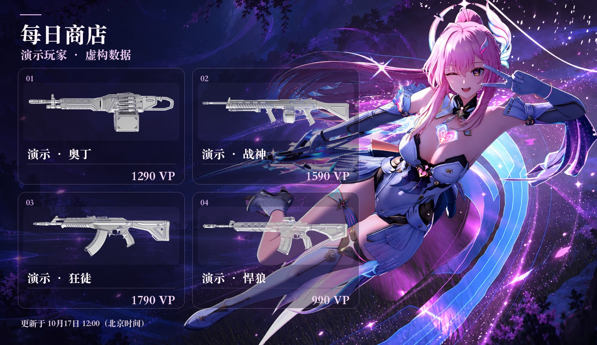
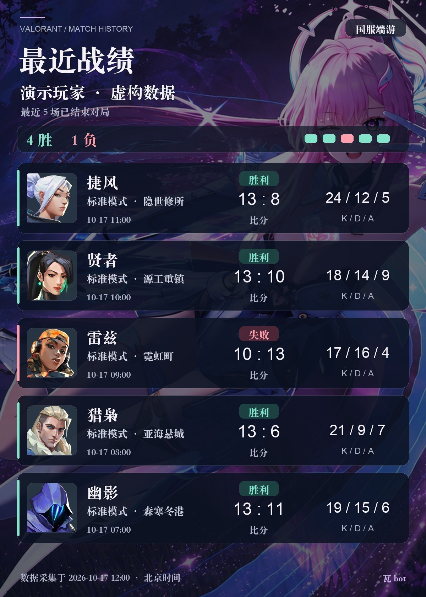
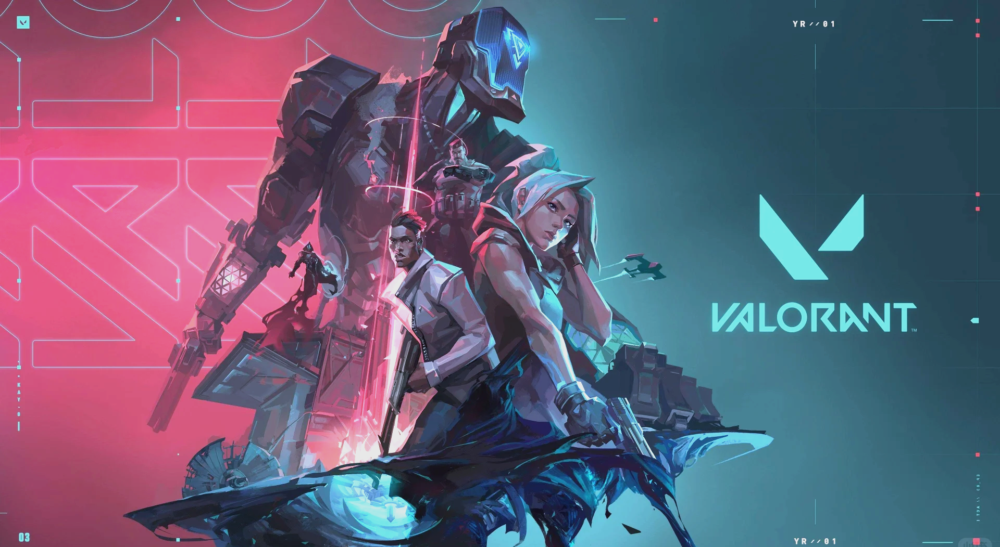
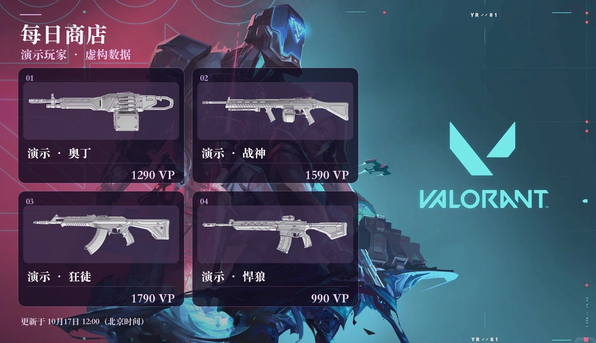

# 瓦bot · Valorant-bot

**在 QQ 群里查看国服无畏契约商店、关注心愿皮肤、分享最近战绩。**

[功能介绍](#功能介绍) · [效果展示](#效果展示) · [常用指令](#常用指令) · [安装与配置](REQUIREMENTS.md) · [版本记录](VERSION_HISTORY.md)

## 功能介绍

| 能力 | 使用体验 |
| --- | --- |
| 每日商店 | 查询自己或同群已绑定成员的商店，图片展示商品与价格 |
| 心愿皮肤 | 添加皮肤愿望，商品上架后由机器人提醒 |
| 最近战绩 | 查看最近 5 场已结束的国服端游对局，展示英雄、地图、比分与 K/D/A |
| 游戏好友 | 查找自己的游戏好友，通过选择码查看好友战绩，无需对方在群内绑定 |
| QQ / 微信授权 | 本人扫码绑定，凭据加密保存，自动维护登录；失效后可重新授权 |
| 自定义卡片 | 固定背景或本地随机图片池，商店和战绩可分别设置 |
| 异常回退 | 自定义背景不可用时使用内置保底图；卡片生成失败时回复文字 |

这是可独立部署的精简运行版，使用 NoneBot2、OneBot V11 和 Pillow。支持 Linux 与 macOS；QQ 接入端和中文字体由部署者准备。

## 效果展示

### 自定义背景风格

下面使用项目现有背景素材与**虚构演示数据**生成卡片，仅展示外观，不代表真实账号、商店价格或对局记录。展示素材与运行时默认背景分开，下载项目后不会自动启用这套自定义背景。

| 每日商店 | 最近战绩 |
| :---: | :---: |
|  |  |

查看这套自定义背景原图

### 下载版的内置保底背景

未配置背景，或自定义图片失效时，商店与战绩都会使用下面这张 VALORANT 图片；图片本身也无法读取时，继续使用纯色背景。图片随安装包提供，无需联网下载。

查看保底背景生成的商店卡片

想使用自己的背景？参见 [背景设置教程](REQUIREMENTS.md#自定义背景)，无需修改 Python 代码。

## 常用指令

| 命令 | 功能 |
| --- | --- |
| `瓦绑定` / `瓦绑定 QQ` / `瓦绑定 微信` | 扫码绑定游戏账号 |
| `每日商店` / `每日商店 @群友` | 查询本人或本群已绑定成员的商店 |
| `战绩` / `战绩 @群友` | 查询最近 5 场已结束对局 |
| `游戏好友 [关键词]` | 查询游戏好友列表及选择码 |
| `好友战绩 选择码` | 查询对应好友最近战绩 |
| `皮肤提醒 完整商品名称` | 添加皮肤愿望 |
| `愿望单` / `取消提醒 编号` | 查看与管理订阅 |
| `商店帮助` / `战绩帮助` / `游戏好友帮助` | 查看帮助 |

更多账号管理指令见 [完整指令说明](REQUIREMENTS.md#账号管理与命令行)。

## 开始使用

按 [REQUIREMENTS.md](REQUIREMENTS.md) 完成环境准备、安装、QQ 接入与启动。后台运行、配置参数、背景示例、升级和常见问题都在该文档中。

只想使用核心查询，也可通过独立命令行完成登录、商店查询及愿望管理，无需连接 QQ。

## 使用说明

- 仅面向国服端游；上游接口和授权状态会影响可用性，不承诺永久免扫码。
- 同群已绑定成员可互查商店与战绩，结果发在群内；游戏好友查询使用发起人的游戏授权和好友关系。
- 项目不附带真实账号、运行配置、私有背景池、商品缓存或系统字体。图片及游戏素材的说明见 [ASSETS.md](ASSETS.md)。
- 本仓库维护独立的公开运行版；部署与升级由使用者自行执行。配置和运行数据保存在自己的 `data/` 目录。

## 相关项目

感谢 [NoneBot2](https://github.com/nonebot/nonebot2)、[OneBot V11 适配器](https://github.com/nonebot/adapter-onebot) 和 [Pillow](https://github.com/python-pillow/Pillow)。

项目首页的功能分区、效果展示与文档导航组织参考了 [nonebot-plugin-varolant](https://github.com/luoye520ww/nonebot-plugin-varolant) 与 [nonebot-plugin-steam-info](https://github.com/zhaomaoniu/nonebot-plugin-steam-info)；功能和配置以本项目说明为准。
